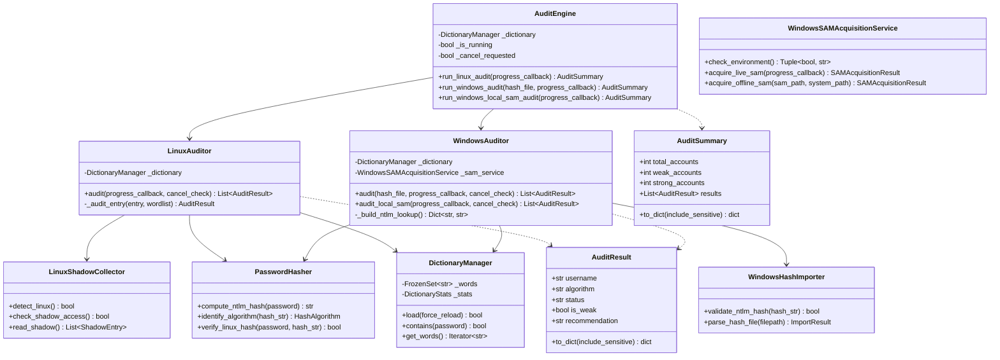

# Sentinel Password Auditor — Architectural Design Document

## 1. System Overview

**Sentinel Password Auditor** is structured into distinct, decoupled layers adhering to SOLID design principles:

- **Presentation Layer (`gui/`, `main.py`):** CustomTkinter graphical interface and headless CLI commands.
- **Orchestration Layer (`core/audit_engine.py`):** Coordinates data collection, dictionary matching, progress notifications, and report compilation.
- **System Collection Layer (`collectors/`):** Safely interacts with operating system files (`/etc/shadow` on Linux) and authorized hash export records on Windows.
- **Auditing Layer (`auditors/`):** Executes cryptographic comparisons and builds normalized `AuditResult` and `AuditSummary` models.
- **Cryptographic & Logic Core (`core/`):** Dictionary management, password hashing algorithms, entropy analysis, and policy enforcement.
- **Reporting Layer (`reports/`):** Sanitized PDF and JSON document generators.

---

## 2. Component Relationship Diagram

---

## 3. Data Flow Pipelines

### 3.1 Linux System Auditing Flow
1. **Invocation:** User launches `main.py --audit-linux` or triggers audit in GUI.
2. **Privilege & Platform Verification:** `LinuxShadowCollector.check_shadow_access()` verifies Linux OS and read permissions on `/etc/shadow`.
3. **Safe Parsing:** Shadow records are parsed into `ShadowEntry` objects. Locked accounts (`!`, `*`) and empty entries are segregated.
4. **Algorithm Identification:** `PasswordHasher.identify_algorithm()` inspects hash prefixes (`$6$`, `$5$`, `$2b$`, `$1$`, `$y$`).
5. **Dictionary Verification:** Each candidate word from `DictionaryManager` is hashed with the account's salt and parameters.
6. **Result Assembly:** Matches produce `AuditResult.weak()`; unmatched accounts produce `AuditResult.strong()`. Raw hashes are discarded from the output model.

### 3.2 Windows NTLM Auditing Flow

The Windows auditing engine supports two acquisition modes:

#### Mode A: Live Local SAM Acquisition (Ophcrack Local SAM Workflow)
1. **Privilege & Platform Check:** `WindowsSAMAcquisitionService.check_environment()` verifies Windows OS and Administrator tokens.
2. **Hive Acquisition:** Safely exports live local SAM and SYSTEM hives to an isolated temporary directory via standard Windows administrative commands (`reg save HKLM\SAM` and `reg save HKLM\SYSTEM`).
3. **Syskey Extraction:** Decodes the 16-byte BootKey from class attributes of `SYSTEM\ControlSet001\Control\Lsa\JD`, `Skew1`, `GBG`, `Data` using the standard transform matrix.
4. **HBootKey Derivation:** Decrypts the SAM domain key from `SAM\Domains\Account\F` value using AES-128-CBC (Windows Vista/7/8/10/11) or RC4 (legacy).
5. **Account Hash Decryption:** Traverses user accounts in `SAM\Domains\Account\Users`, decrypts individual NTLM hashes in-memory using AES-128 and RID-derived DES keys.
6. **Zero Retention Cleanup:** The temporary directory and exported hives are wiped and purged immediately in a `finally` block before dictionary matching begins.
7. **O(1) Matching:** Accounts are matched against the pre-computed dictionary NTLM table.

#### Mode B: Authorized Hash File Import
1. **Import:** User provides path to authorized `username:NTLM_HASH` file.
2. **Validation:** `WindowsHashImporter` validates 32-character hexadecimal format.
3. **Lookup Optimization:** Pre-computes NTLM hashes for all words in `wordlist.txt` once into an in-memory dictionary (`dict[ntlm_hash, word]`).
4. **O(1) Matching:** For each imported account, lookup is executed in $O(1)$ time complexity.
5. **Result Assembly:** Matched accounts produce `AuditResult.weak()`; unmatched accounts produce `AuditResult.strong()`.

### 3.3 Interactive Password Checker Flow
1. **Input:** User types password into masked field in GUI or passes `--check <password>` via CLI.
2. **Normalization:** Whitespace is trimmed and case-insensitive representation is prepared.
3. **Dictionary Check:** Evaluated in $O(1)$ against `DictionaryManager._words` (frozenset).
4. **Entropy & Heuristic Scoring:** `PasswordChecker` evaluates:
   - Length (8 to 20+ characters).
   - Character diversity (upper, lower, digit, special).
   - Character repetition penalties (e.g. `aaaa`).
   - Sequential character penalties (e.g. `12345`, `abcdef`).
   - Keyboard walk patterns (e.g. `qwerty`, `asdfgh`).
   - Leetspeak predictable substitutions (e.g. `@` -> `a`, `3` -> `e`).
5. **Policy Compliance:** Checked against `PasswordPolicy` rules (length, complexity, dictionary absence).
6. **Output:** Immediate score (0-100), strength classification, and remediation guidance displayed to user. The password is never saved or logged.
